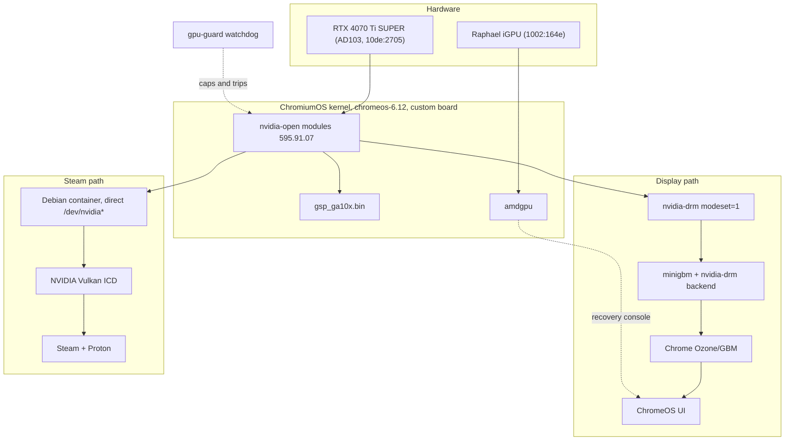
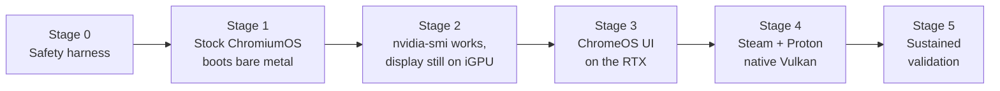

# Architecture

The goal: boot ChromiumOS on bare metal, have the NVIDIA driver load from its own
kernel stack, drive the ChromeOS UI on the RTX 4070 Ti SUPER, and run Steam/Proton
with native Vulkan.

## Target stack

## The version triple

The kernel module, the userspace libraries, and the GSP firmware must be the same
version or the module refuses to load. This is the project's single most important
invariant, so it lives in `safety/limits.conf` as `NVIDIA_DRIVER_VERSION` and every
ebuild derives from it.

| Component | Source | Pin |
| --- | --- | --- |
| Kernel modules | `NVIDIA/open-gpu-kernel-modules` | tag `595.91.07` |
| Userspace + firmware | `NVIDIA-Linux-x86_64-595.91.07.run` | `--extract-only`, never executed |
| GSP firmware | from the `.run` | `gsp_ga10x.bin` |

A mismatch is a load failure, not a hardware risk. It is annoying, not dangerous.

## Why bare metal is safe here

The iGPU is the whole answer. With the BIOS primary display set to the CPU/iGPU,
`amdgpu` owns the console and the NVIDIA driver is free to fail without locking us out
of the machine. Combined with installing only to a spare disk, the worst outcome of a
bad boot is a reboot.

`safety/preflight.sh` enforces both conditions before any bare-metal test, and
`SAFETY.md` explains why driver faults cannot damage the card.

## Stage gates

Each stage ends in a check that must pass before the next begins. The ordering is
deliberate: the driver loads completely before it is allowed anywhere near the
display, so the riskiest-looking step happens while a known-good console is still
guaranteed.

- **Stage 0** — safety scripts exist and the guard's ladder is proven by self-test.
- **Stage 1** — stock `amd64-generic` boots from `nvme1n1`, iGPU driving display, RTX
  blacklisted. Establishes that the build and boot path work before adding variables.
- **Stage 2** — `/dev/nvidia0` present and `nvidia-smi` reporting the card from the
  ChromeOS shell, **while the display is still on the iGPU**. Full driver load with
  zero display dependency: the safest possible checkpoint.
- **Stage 3** — `nvidia-drm.modeset=1`, patched minigbm, Chrome's Ozone on NVIDIA EGL.
  The real research risk.
- **Stage 4** — Steam container with direct device access; `vkcube`, then `vulkaninfo`
  showing the NVIDIA ICD, then a game.
- **Stage 5** — sustained thermal and power logging, then relax the conservative
  bring-up caps toward stock.

## Known hard problems

Recorded honestly so they are not rediscovered as surprises.

### ~~ChromeOS kernel toolchain versus an out-of-tree module~~ (not a problem: verified)

This was assumed to be Stage 2's main obstacle. It is not. Grepping the whole of
`chromeos/config/` in the synced 6.12 tree:

| Symbol | Occurrences | Reality |
| --- | --- | --- |
| `CONFIG_CFI_CLANG` | 0 | Never enabled. |
| `CONFIG_LTO_CLANG*` | 0 | Never enabled. |
| `CONFIG_TRIM_UNUSED_KSYMS` | 0 | Never enabled. |
| `CONFIG_MODULE_SIG_FORCE` | 1 | Only in reven's flavour config, which this board does not inherit. |

Confirmed a second way, by concatenating the three files `prepareconfig` actually uses for
our board and searching the resulting 887-line config: all four are absent. So nothing
needs relaxing, and no exploit mitigation is being given up. The kernel is still built with
clang, so the NVIDIA interface layer must use the same toolchain — but that is ordinary
cross-compilation, not a blocker.

### Chrome expects Mesa, NVIDIA is not Mesa

ChromeOS's graphics path assumes Mesa's EGL and minigbm's allocator. NVIDIA ships its
own EGL implementation plus `libnvidia-egl-gbm` and `libnvidia-allocator`. Bridging
these is Stage 3 and may require patching Chrome's GPU initialisation rather than
merely setting `__EGL_VENDOR_LIBRARY_DIRS`.

The minigbm dumb-buffer backend should be enough to get pixels on screen, because
dumb buffers are linear and driver-agnostic. Getting *accelerated* scanout, with
Chrome rendering into buffers the display engine can read directly, is the harder half.

### ChromeOS does not select GL drivers with VIDEO_CARDS

Worth stating plainly because it is not how Gentoo normally works, and assuming otherwise
silently produces a software-rendered image.

ChromeOS does not build one `media-libs/mesa` with gallium drivers chosen by
`VIDEO_CARDS`. It ships **split packages** — `mesa-amd`, `mesa-iris`, `mesa-radv`,
`mesa-llvmpipe`, `mesa-freedreno`, `mesa-panfrost`, `mesa-reven` — each hardcoding its
driver. `mesa-amd` passes `-Dgallium-drivers=radeonsi` unconditionally and reads no
`VIDEO_CARDS` at all.

The choice is made by `virtual/opengles` and `virtual/vulkan-icd`, which boards override.
`amd64-generic` points both at `mesa-llvmpipe`, because it is a VM target: its GL is
**software rendering**. Inheriting that unchanged would have given us a kernel driving the
iGPU through amdgpu and then never using it for GL. This overlay therefore overrides both
virtuals to `mesa-amd` and `mesa-radv`, matching `chipset-cezanne`, `chipset-mendocino` and
`overlay-grunt`.

`VIDEO_CARDS` still matters, just for other things: minigbm's backends, `LICENSE`
selection, and packages that gate on `video_cards_*` directly. `llvmpipe` is kept in it
because in `media-libs/mesa` it maps to `gallium_enable video_cards_llvmpipe swrast` — it is
the software rasteriser, the only GL that needs no working kernel driver, and so the last
line of the recovery story.

### The iGPU needs firmware ChromeOS does not ship

Enabling `CONFIG_DRM_AMDGPU` is necessary but not sufficient, and this is the one blocker
that had no existing mechanism to reuse.

Raphael `[1002:164e]` has no legacy firmware alias: `amdgpu_ucode_legacy_naming()` has no
case for GC `IP_VERSION(10, 3, 6)`, SDMA `5.2.6`, or VCN `3.1.2`, so all three fall through
to IP-derived names. ChromeOS's `linux-firmware` fork carries the `gc_10_3_7` set
(Mendocino) but nothing for ours, and — more decisively — its ebuild has **no USE flag that
installs general amdgpu firmware at all**. The only amdgpu flags are `amdgpu_gc_11_0_1`,
`amdgpu_gc_11_0_4` and `amdgpu_yellow_carp`; `video_cards_amdgpu` only selects a `LICENSE`
entry. The builtin-firmware route has the same gap: `cros-kernel.eclass` defines
`builtin_fw_amdgpu_gc_10_3_7` but no `gc_10_3_6`.

So `sys-firmware/amdgpu-raphael-firmware` in this overlay ships the eleven files, staged by
`tools/fetch-amdgpu-firmware.sh`. Every one is on a fatal path — the request sites all
propagate their error up through `early_init`/`sw_init`, so one missing file means no iGPU:

| IP block | Files | Requested by |
| --- | --- | --- |
| GC 10.3.6 | `gc_10_3_6_{pfp,me,ce,rlc,mec,mec2}.bin` | `gfx_v10_0_init_microcode()` |
| SDMA 5.2.6 | `sdma_5_2_6.bin` | `amdgpu_sdma_init_microcode()` |
| PSP 13.0.5 | `psp_13_0_5_{toc,ta}.bin` | `psp_v13_0_init_microcode()`, both `if (err) return err` |
| VCN 3.1.2 | `vcn_3_1_2.bin` | `amdgpu_vcn_early_init()` |
| DCN 3.1.6 | `dcn_3_1_6_dmcub.bin` | display core |

No `smu_13_0_5.bin`: on this APU the SMU firmware comes from the platform BIOS, and
upstream `linux-firmware` ships no such file. No `psp_13_0_5_asd.bin` either —
`psp_init_asd_microcode()` is never called for MP0 13.0.5.

The BSP depends on this package *outside* the `nvidia_open` USE gate, because the iGPU is
the recovery console and is most needed exactly when the NVIDIA driver is off or broken.

If the iGPU console is dead, check `dmesg` for failed `amdgpu/gc_10_3_6_*` requests before
suspecting the kernel config.

### Firmware size

`gsp_ga10x.bin` is 72 MB. ChromeOS rootfs partitions are size-constrained, so the
firmware ebuild installs only the one GSP image Ada needs rather than the whole set.

### Steam has to be built, not enabled

Borealis is gone and was never open. The container in `steam/` is this project's own
construction, not a ChromeOS feature being switched on.

## Repository layout

| Path | Purpose |
| --- | --- |
| `SAFETY.md` | What can and cannot hurt the card; the test protocol |
| `safety/` | `limits.conf`, guard, preflight, VBIOS backup |
| `sdk/` | Host bootstrap and build wrappers |
| `overlay/` | Portage board overlay for the `nvidia-generic` board |
| `patches/` | minigbm and kernel config patches |
| `steam/` | Steam/Proton container definition |
| `tools/` | `flash.sh` with a disk allowlist |
| `docs/` | Hardware facts, research notes, this file |
