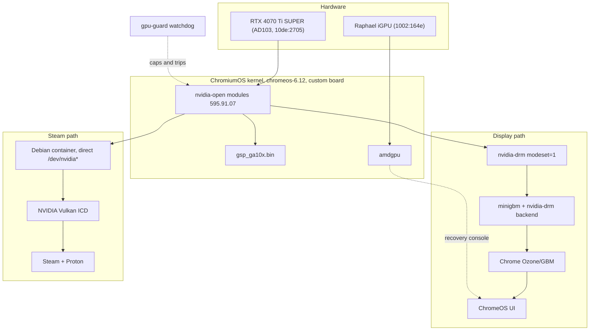
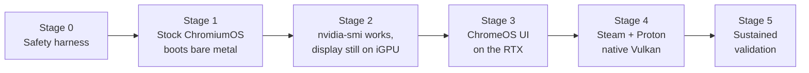

# Architecture

The goal: boot ChromiumOS on bare metal, have the NVIDIA driver load from its own
kernel stack, drive the ChromeOS UI on the RTX 4070 Ti SUPER, and run Steam/Proton
with native Vulkan.

## Target stack

## The version triple

The kernel module, the userspace libraries, and the GSP firmware must be the same
version or the module refuses to load. This is the project's single most important
invariant, so it lives in `safety/limits.conf` as `NVIDIA_DRIVER_VERSION` and every
ebuild derives from it.

| Component | Source | Pin |
| --- | --- | --- |
| Kernel modules | `NVIDIA/open-gpu-kernel-modules` | tag `595.91.07` |
| Userspace + firmware | `NVIDIA-Linux-x86_64-595.91.07.run` | `--extract-only`, never executed |
| GSP firmware | from the `.run` | `gsp_ga10x.bin` |

A mismatch is a load failure, not a hardware risk. It is annoying, not dangerous.

## Why bare metal is safe here

The iGPU is the whole answer. With the BIOS primary display set to the CPU/iGPU,
`amdgpu` owns the console and the NVIDIA driver is free to fail without locking us out
of the machine. Combined with installing only to a spare disk, the worst outcome of a
bad boot is a reboot.

`safety/preflight.sh` enforces both conditions before any bare-metal test, and
`SAFETY.md` explains why driver faults cannot damage the card.

## Stage gates

Each stage ends in a check that must pass before the next begins. The ordering is
deliberate: the driver loads completely before it is allowed anywhere near the
display, so the riskiest-looking step happens while a known-good console is still
guaranteed.

- **Stage 0** — safety scripts exist and the guard's ladder is proven by self-test.
- **Stage 1** — stock `amd64-generic` boots from `nvme1n1`, iGPU driving display, RTX
  blacklisted. Establishes that the build and boot path work before adding variables.
- **Stage 2** — `/dev/nvidia0` present and `nvidia-smi` reporting the card from the
  ChromeOS shell, **while the display is still on the iGPU**. Full driver load with
  zero display dependency: the safest possible checkpoint.
- **Stage 3** — `nvidia-drm.modeset=1`, patched minigbm, Chrome's Ozone on NVIDIA EGL.
  The real research risk.
- **Stage 4** — Steam container with direct device access; `vkcube`, then `vulkaninfo`
  showing the NVIDIA ICD, then a game.
- **Stage 5** — sustained thermal and power logging, then relax the conservative
  bring-up caps toward stock.

## Known hard problems

Recorded honestly so they are not rediscovered as surprises.

### ChromeOS kernel toolchain versus an out-of-tree module

The ChromeOS kernel is built with clang, and typically with LTO and CFI enabled.
NVIDIA's kernel interface layer must be compiled by the same toolchain that built the
kernel, and CFI in particular tends to reject out-of-tree modules that make indirect
calls across the kernel boundary. The custom board kernel therefore likely needs CFI
and LTO relaxed. `CONFIG_MODULE_SIG_FORCE` must also be checked, since a forced
signature requirement would reject our module outright.

This is Stage 2's main obstacle and the reason Stage 2 has its own gate.

### Chrome expects Mesa, NVIDIA is not Mesa

ChromeOS's graphics path assumes Mesa's EGL and minigbm's allocator. NVIDIA ships its
own EGL implementation plus `libnvidia-egl-gbm` and `libnvidia-allocator`. Bridging
these is Stage 3 and may require patching Chrome's GPU initialisation rather than
merely setting `__EGL_VENDOR_LIBRARY_DIRS`.

The minigbm dumb-buffer backend should be enough to get pixels on screen, because
dumb buffers are linear and driver-agnostic. Getting *accelerated* scanout, with
Chrome rendering into buffers the display engine can read directly, is the harder half.

### Firmware size

`gsp_ga10x.bin` is 72 MB. ChromeOS rootfs partitions are size-constrained, so the
firmware ebuild installs only the one GSP image Ada needs rather than the whole set.

### Steam has to be built, not enabled

Borealis is gone and was never open. The container in `steam/` is this project's own
construction, not a ChromeOS feature being switched on.

## Repository layout

| Path | Purpose |
| --- | --- |
| `SAFETY.md` | What can and cannot hurt the card; the test protocol |
| `safety/` | `limits.conf`, guard, preflight, VBIOS backup |
| `sdk/` | Host bootstrap and build wrappers |
| `overlay/` | Portage board overlay for the `nvidia-generic` board |
| `patches/` | minigbm and kernel config patches |
| `steam/` | Steam/Proton container definition |
| `tools/` | `flash.sh` with a disk allowlist |
| `docs/` | Hardware facts, research notes, this file |
